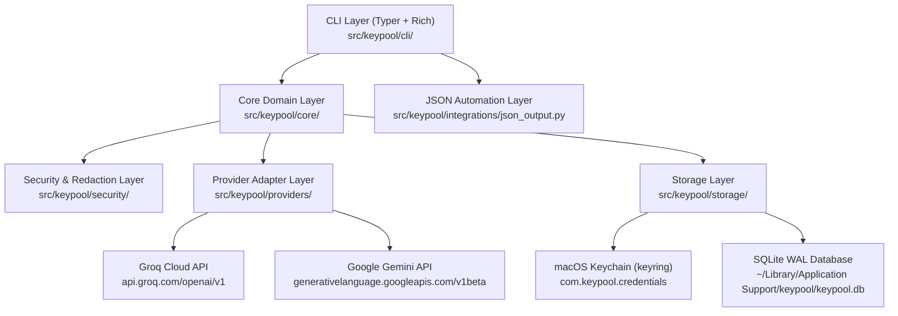

# KEYPOOL Architecture

## 1. Design Principles

KEYPOOL is architected as a modular, local-first macOS CLI application with strict separation of concerns:

1. **Zero Secret Persistence Outside macOS Keychain:** SQLite stores only non-secret metadata (`id`, `name`, `provider`, `keychain_reference`, timestamps, and sanitized health observations).
2. **Provider Independence:** Adding a new provider requires only implementing `BaseProvider` and registering it in `ProviderRegistry`—zero changes to `CredentialManager`, `ProfileManager`, `SelectionEngine`, `ExecutionManager`, or the SQLite schema.
3. **Consumer Independence:** KEYPOOL has zero coupling to any downstream consumer (such as RPX, pytest suites, or standalone scripts). Consumers interact with KEYPOOL strictly through `keypool exec`, `keypool get`, or `--json` CLI contracts.
4. **Offline Local Operations:** All local credential, profile, usage, and cached health operations work offline without network calls. Network requests occur only during explicit `keypool test` or `keypool health --refresh` invocations.

## 2. Layered Component Architecture

## 3. Data Storage & Schema

Application files reside in `~/Library/Application Support/keypool/` (or `$KEYPOOL_HOME` when overridden for isolated testing) with `0700` directory permissions and `0600` file permissions:

- `keypool.db`: SQLite database running in `WAL` mode with `foreign_keys=ON`.
  - `schema_migrations`: Tracks applied schema versions (`SCHEMA_VERSION = 1`).
  - `credentials`: Non-secret credential metadata (`id`, `name`, `provider`, `keychain_reference`, `enabled`, `status`, timestamps, cooldowns, sanitized error summaries).
  - `health_observations`: Historical and cached health check records.
  - `model_cache`: Per-credential discovered model availability cache.
  - `profiles`: Built-in (`testing`, `development`, `production`) and user-defined execution profiles.
  - `profile_assignments`: Explicit many-to-many mapping between profiles and credentials with priority ordering.
  - `usage_events`: Locally observed selections, child executions, HTTP 429 events, and probe token counts.
- `config.toml`: Validated runtime configuration (`KeypoolSettings`).
- `logs/keypool.log`: Application log protected by `RedactingLogFilter` and `RedactingFormatter`.

## 4. Two-Phase Storage Consistency & Reconciliation

- **Credential Creation:** Writes the secret to macOS Keychain first (`keypool:cred_<hex>`), then inserts the SQLite metadata row inside a transaction. If the SQLite transaction fails, `CredentialManager` immediately deletes the Keychain item so no orphaned secret remains.
- **Credential Removal:** Deletes the macOS Keychain item first, then deletes the SQLite metadata record (which cascades to profile assignments, health observations, and model cache).
- **Reconciliation (`reconcile_storage`):** Verifies every SQLite credential's `keychain_reference` against macOS Keychain. Any credential whose Keychain secret was removed externally is transitioned to `keychain_error` and flagged by `keypool doctor` without destroying user metadata.

